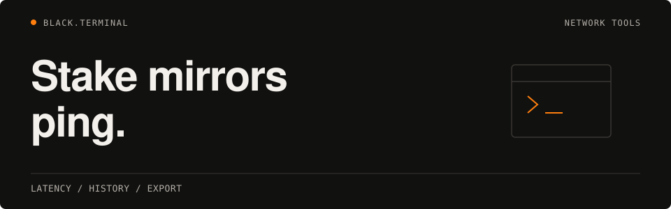

<h1>
  <picture>
    <source media="(max-width: 600px)" srcset="assets/readme/hero-mobile.svg">
    
  </picture>
</h1>

**stake-mirrors-ping** measures Stake mirror latency through a Python CLI and Electron desktop GUI, with NordVPN region recommendations, scan history, and JSON/CSV export.

**[Quick start](#quick-start)** · [Features](#features) · [CLI options](#cli-options) · [Configuration](#config) · [Architecture](#architecture)

[](https://www.python.org/downloads/)
[](LICENSE)
[](https://github.com/subkoks/stake-mirrors-ping/releases)

## Quick start

### CLI

```bash
# Install locked Python dependencies (Python 3.12+)
uv sync --locked
source .venv/bin/activate

# Basic ping test (no API key needed)
python -m src.main

# With API latency tests
cp .env.example .env  # add your STAKE_SESSION_TOKEN
python -m src.main --api

# With $0 Dice bet latency benchmark
python -m src.main --api --benchmark-bets

# Export results
python -m src.main --export json
python -m src.main --export csv

# Live dashboard (refresh every 30s)
python -m src.main --live 30

# Live dashboard with API tests
python -m src.main --live 30 --api --skip-vpn

# View uptime history stats
python -m src.main --history

# Skip NordVPN / GeoIP
python -m src.main --skip-vpn --skip-geoip

# Custom rounds and timeout
python -m src.main --rounds 5 --timeout 15
```

### Desktop GUI

```bash
# Development mode
cd gui
npm ci
npm start

# Production build (creates installers in gui/dist/)
npm run build:mac    # macOS
npm run build:win    # Windows
npm run build:linux  # Linux
```

Packaged desktop apps require **Python 3.12+ and the versions in
`requirements.txt` installed separately**. Python is not bundled or downloaded.
The GUI checks the interpreter version, imports, and dependency minimums before
enabling scans. Missing/incompatible Python shows installation guidance in the
window.

For a Finder-launched macOS app, create a separate environment without changing
your system Python. For example, with the app installed in `/Applications`:

```sh
python3 -m venv "$HOME/.local/share/stake-mirrors-ping/python"
"$HOME/.local/share/stake-mirrors-ping/python/bin/python" -m pip install -r "/Applications/Stake Mirrors Ping.app/Contents/Resources/requirements.txt"
mkdir -p "$HOME/Library/Application Support/Stake Mirrors Ping"
printf '%s\n' "$HOME/.local/share/stake-mirrors-ping/python/bin/python" > "$HOME/Library/Application Support/Stake Mirrors Ping/python-path.txt"
```

Restart the app after setting the executable path. The error message shows the
actual preference-file location for your platform. `STAKE_PYTHON` is an alternative
absolute executable-path override for terminal launches. An explicit choice is
validated and never silently replaced. Without one, development prefers the
project `.venv`; packaged macOS apps try Homebrew's standard locations and then
`python3` on PATH (Windows tries `python`). A GUI launch does not inherit an
activated terminal environment reliably.

Code/resources live under `process.resourcesPath`; writable configuration/history
live in Electron's per-user application data directory. First launch copies the
bundled canonical configuration, preserving an existing user configuration.
`--user-data-dir=/absolute/directory` selects an isolated data directory for
verification. macOS builds require **macOS 12 or newer** (older macOS versions supported by
the former Electron runtime are no longer supported). Installers are **unsigned
and not notarized**. Node **22.12.0+ within
22.x** is required for development/packaging; CI pins 22.23.1.

Developer-only offline rendered checks:

```sh
cd gui
npm ci --omit=optional --registry=https://registry.npmjs.org
npm test
npm run test:electron
npm run build:check -- --publish never
npm run test:electron:packaged  # macOS app built above
```

These checks use temporary data, controlled Python environments and mocked scans.
Playwright is not included in the packaged application. See the
[security upgrade evidence](docs/gui-security-upgrade.md) for version selection,
advisory remediation and compatibility notes.

## Features

- **Offline mirror inventory** shared by CLI and GUI, with bounded concurrent TCP/HTTP/DNS probes
- **Explicit mirror refresh** with preview, validation, provenance, and retention of custom entries
- **GeoIP lookup** — see where each mirror's server is located
- **NordVPN recommendations** — best EU server city per mirror
- **Stake API integration** — GraphQL latency via `curl_cffi` (Chrome TLS fingerprint; blocked responses remain possible)
- **Live dashboard** — real-time auto-refreshing terminal UI with `rich.live`
- **History tracking** — SQLite-based latency history with uptime stats
- **Rich CLI** — color-coded sorted table, successful HTTP latency first
- **Export** — save results to JSON or CSV
- **Desktop GUI** — Electron-based cross-platform desktop application

## Stake API setup (optional)

1. Open Stake.com in your browser
2. Open DevTools (F12) → Application → Cookies
3. Copy the `session` cookie value
4. Create `.env` file:

   ```text
   STAKE_SESSION_TOKEN=your_session_token_here
   ```

5. Run with `--api` flag

## CLI options

| Flag                | Description                               |
| ------------------- | ----------------------------------------- |
| `--config FILE`     | Custom config file (default: config.yaml) |
| `--rounds N`        | Number of ping rounds (default: 3)        |
| `--timeout N`       | Timeout in seconds (default: 10)          |
| `--api`             | Enable Stake API latency tests            |
| `--benchmark-bets`  | Enable $0 Dice bet latency test           |
| `--skip-geoip`      | Skip GeoIP lookups                        |
| `--skip-vpn`        | Skip NordVPN recommendations              |
| `--export json/csv` | Export results to file                    |
| `--output-dir DIR`  | Output directory (default: results/)      |
| `--live SECONDS`    | Live dashboard with auto-refresh          |
| `--watch SECONDS`   | Legacy continuous monitoring              |
| `--history`         | Show uptime stats from history.db         |
| `--no-history`      | Don't save results to history.db          |

## Output example

```text
┌───┬──────────────┬────────┬─────────────────┬──────────────────┬────────┬────────┬────────┬───────┐
│ # │ Mirror       │ Status │ IP              │ Location         │ TCP    │ HTTPS  │ API    │ Best  │
├───┼──────────────┼────────┼─────────────────┼──────────────────┼────────┼────────┼────────┼───────┤
│ 1 │ stake.bet 🔒 │ HTTP   │ 104.22.10.123   │ London, UK       │ 12.3ms │ 45.6ms │ 89.1ms │ 45.6ms│
│ 2 │ stake.ac 🔒  │ HTTP   │ 172.67.182.45   │ Amsterdam, NL    │ 18.7ms │ 52.3ms │ 95.4ms │ 52.3ms│
│ ...                                                                                              │
└───┴──────────────┴────────┴─────────────────┴──────────────────┴────────┴────────┴────────┴───────┘

🏆 LOWEST HTTP LATENCY: stake.bet — 45.6ms

🎯 RECOMMENDED: NordVPN → London, UK → stake.bet (Est. 60.6ms)
```

## Config

Edit `config.yaml` to add/remove mirrors, change settings, or modify NordVPN target regions.
The [refresh guide](docs/mirrors/refresh.md) explains the explicit updater,
source/count semantics, retained domains, validation and failure behavior.

```sh
uv run --frozen python -m src.mirror_update         # preview only
uv run --frozen python -m src.mirror_update --apply # additive refresh
```

A responding HTTP endpoint is not proof of an authentic or healthy application.
403, 429, redirects, and local timeouts have separate labels. The ranking metric
is HTTP HEAD latency, with unsuccessful results last; TCP/API timings are shown
separately. The sample below is illustrative, not a current live-health claim.

## Architecture

```
┌─────────────────────────────────────────────────────────────┐
│                     Desktop GUI (Electron)                    │
│  ┌──────────────┐  ┌──────────────┐  ┌──────────────┐     │
│  │  Mirrors Tab │  │ Dashboard    │  │  History Tab │     │
│  └──────────────┘  └──────────────┘  └──────────────┘     │
└─────────────────────────────────────────────────────────────┘
                           │ JSON-RPC
                           ▼
┌─────────────────────────────────────────────────────────────┐
│              Python API Bridge (src/core/api.py)             │
└─────────────────────────────────────────────────────────────┘
                           │
                           ▼
┌─────────────────────────────────────────────────────────────┐
│              Core API (src/core/__init__.py)                 │
│  ┌──────────────────────────────────────────────────────┐   │
│  │ OrchestratorConfig | run_scan() | ScanResult        │   │
│  │ Serializers (Pydantic) | HistoryDB                 │   │
│  └──────────────────────────────────────────────────────┘   │
└─────────────────────────────────────────────────────────────┘
                           │
                           ▼
┌─────────────────────────────────────────────────────────────┐
│                     Core Services                            │
│  ┌─────────┐ ┌──────────┐ ┌──────────┐ ┌──────────┐        │
│  │ Pinger  │ │ GeoIP    │ │ Stake   │ │ NordVPN  │        │
│  └─────────┘ └──────────┘ └──────────┘ └──────────┘        │
└─────────────────────────────────────────────────────────────┘
```

## Tech stack

- Python 3.12+ with asyncio
- Pydantic v2 (data validation and serialization)
- curl_cffi (Chrome TLS fingerprint)
- aiohttp + aiodns (async HTTP/DNS)
- rich (beautiful CLI output + live dashboard)
- SQLite (history tracking)
- PyYAML + python-dotenv (config)
- Electron + Node.js (desktop GUI)
- electron-builder (cross-platform packaging)

## Codex CLI

Codex CLI can use the repo root `AGENTS.md` and the tracked `.codex/config.toml` defaults in this workspace.

---

 **BLACK.TERMINAL** · [MIT License](LICENSE) · [GitHub](https://github.com/subkoks)
