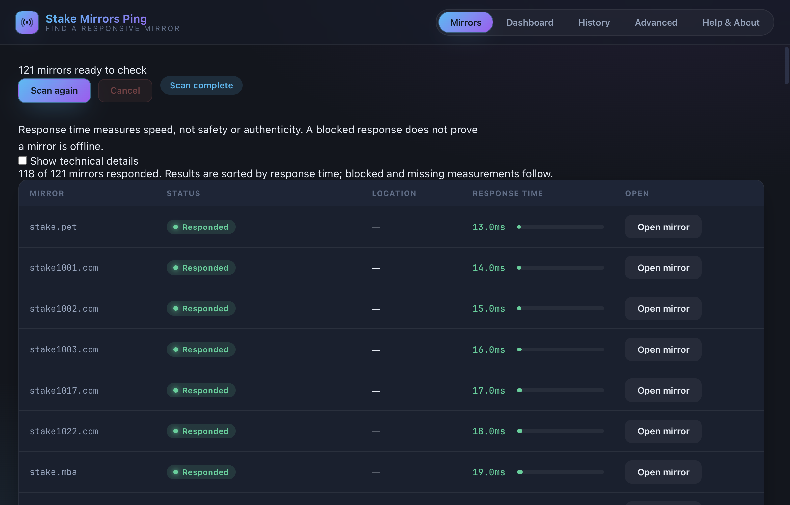

# Stake Mirrors Ping

Find responsive Stake mirrors from a desktop window. Start a scan, compare response times, and open a mirror in your browser. No account or login is needed to scan.

*Actual packaged desktop interface with deterministic test results, not live mirror measurements.*

**[Downloads](https://github.com/subkoks/stake-mirrors-ping/releases/latest)** · [Troubleshooting](#troubleshooting) · [Development and CLI](docs/development.md)

**Latest release: [v2.1.0 — Self-contained Desktop](https://github.com/subkoks/stake-mirrors-ping/releases/tag/v2.1.0).** Includes its Python scan engine and dependencies. Downloads are unsigned; macOS builds are not notarized. v2.0.0 and its files remain unchanged.

## Install and scan

For the self-contained desktop release:

1. Choose the download for your operating system and processor.
2. Install the app and open **Stake Mirrors Ping**.
3. Click **Start scan**. Progress shows how many mirrors have been checked.
4. Compare the sorted results and click **Open mirror** for your choice. Use **Cancel** or **Scan again** when needed.

Python, Node, Git, a terminal, and package installation are **not required** by the bundled desktop app. Backend setup does not use the internet or install anything into your system Python. Network access is needed to scan mirrors and check for updates.

| Desktop target | Support baseline | Download |
| --- | --- | --- |
| Windows x64 | Windows 10/11; CI validation uses Windows Server | Setup EXE; portable EXE |
| macOS Apple Silicon | macOS 13+ | arm64 DMG/ZIP |
| macOS Intel | macOS 13+ | x64 DMG/ZIP |
| Linux x64 | Ubuntu 22.04/24.04 desktop, glibc 2.35+ | DEB or AppImage; RPM is built separately and needs distribution qualification |

Minimum-version compatibility and the exact installer/interaction evidence are documented in [desktop distribution](docs/desktop-distribution.md). Linux support is not a claim about every distribution. Windows ARM and Linux ARM are not included.

### Installation notes

- **Windows:** run the Setup EXE. The portable EXE is an alternative that does not install the app.
- **macOS:** open the DMG and drag the app into Applications, then open it from Applications.
- **Ubuntu:** open the DEB in your software installer. AppImage execution permissions and FUSE availability vary by desktop; use the DEB when your desktop cannot launch AppImages directly.
- Release builds are **unsigned and not notarized**. Public, frictionless macOS distribution still needs Developer ID signing and notarization. Do not disable OS security protections. If your OS blocks an unsigned release, wait for an appropriately signed release.

## Understand the results

Response time measures speed, not safety or authenticity. “Blocked / challenge” and “Too many requests” do not mean a domain is offline. DNS errors and timeouts describe what this scan observed from your connection.

The app uses its bundled mirror inventory offline. Existing custom settings and inventory are preserved when upgrading; they are not silently replaced. Technical measurements and scan settings remain under **Show technical details** and **Advanced**. History is available in its own tab.

## Updates and support

Open **Help & About → Check for updates**. The app checks the official GitHub release metadata only when you request it and offers the official download page. It does not download or install executable updates automatically. Checksums verify file integrity, not publisher identity.

Use **Open logs / support folder** or **Copy diagnostic summary** when requesting help. The summary excludes user paths, account tokens, configuration, and scan results. No telemetry is sent.

## Troubleshooting

- **No useful results:** check your internet connection and retry. Some mirrors may be restricted or challenged in your region.
- **Some results missing:** keep the successful results; retry later if needed. A missing timing is not ranked as fast.
- **Scan engine cannot start:** use **Retry startup**. If that fails, reinstall from the official release page. You do not need to configure Python.
- **No internet:** the window, bundled configuration, settings and history still work. Scanning and release checks need a connection.
- **Upgrading:** settings and history are stored separately from the app and preserved. Do not remove the application-data folder when reinstalling.

## For developers

The Python CLI remains available. See [development and CLI instructions](docs/development.md), [desktop build/provenance details](docs/desktop-distribution.md), and the [mirror refresh workflow](docs/mirrors/refresh.md). The inventory and its provenance are unchanged by desktop packaging.

[MIT License](LICENSE)
